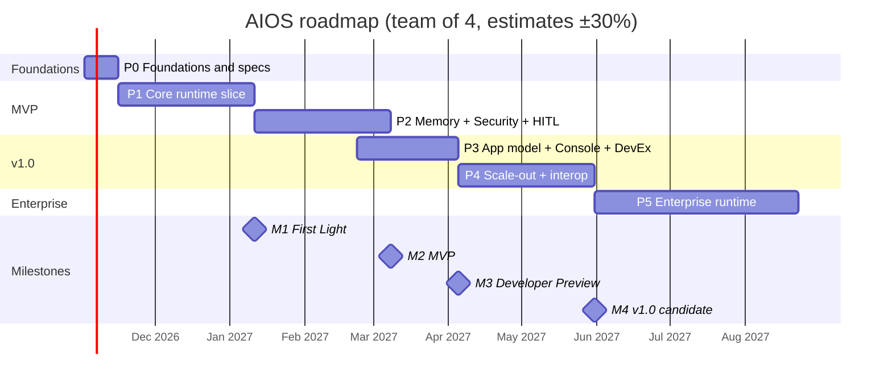

# AIOS — Implementation Plan v1.0

| | |
|---|---|
| **Status** | Draft for review |
| **Date** | 28 October 2026 |
| **Implements** | [project-requirement-v2.md](project-requirement-v2.md) — every FR id there is assigned to a work package below |
| **Horizon** | Phase 0 → v1.0 candidate in ~30 weeks, then the Enterprise phase |

---

## 1. Planning assumptions

- **Team:** 4 engineers (tech lead, platform, AI, full-stack), plus part-time security and product. For a smaller team, see §9.2.
- **Cadence:** 2-week sprints. Estimates are ±30%. The December holidays fall in Phase 1 and are covered by that margin.
- **Stack:** Python 3.12+ runtime and SDK, TypeScript console. Self-hosted first.
- **Calendar:** assumes a start on Monday 2 November 2026. Shift the dates as needed.
- **Decisions:** items marked *ADR* are settled in Phase 0 using the defaults in requirements §11 unless the owner decides otherwise.

## 2. Delivery strategy

1. **Vertical slices driven by reference apps.** Each phase ends with a reference AI App working end to end. Its acceptance tests are written in Phase 0 and turn green phase by phase. Features no reference app needs wait.
2. **Modular monolith first.** One Python package with strict internal boundaries (enforced by import-linter), deployed as two processes: API and worker. Split into services only when scaling data demands it.
3. **Ports, adapters and conformance suites.** Every pluggable backend (bus, vector store, model provider, tool provider, secrets) has one interface and one shared test suite. The in-memory adapter comes first and powers the unit tests.
4. **Spec first.** The event envelope, topic grammar, event catalog and manifests are versioned JSON Schemas before code depends on them.
5. **Build the differentiators, buy the commodities** (§3).
6. **Security from the first commit.** Tenant ids, principals and policy hooks exist from Phase 1, even while policies are still permissive. Retrofitting them later costs far more.

## 3. Build vs. buy

| Capability | Decision | Why |
|---|---|---|
| Message broker | **Buy**: PostgreSQL → NATS JetStream → optional Kafka, behind the AIOS `EventBus` port | Brokers are commodities. |
| Event semantics (envelope, catalog, replay, hop limits, capability routing) | **Build** | Core differentiator. |
| Workflow engine | **Build** an event-sourced graph engine; optional Temporal adapter later | Agent-native semantics and direct use of the event log; avoids deterministic code replay. |
| Model access | **Build** a thin interface over official provider SDKs (LiteLLM as an option underneath, ADR-008) | Keeps accounting, policy and normalization under AIOS control. |
| Policy engine | **Buy**: Cedar (ADR-007, decided) | Proven and analyzable. AIOS YAML compiles to it. |
| Vector store | **Buy**: pgvector, then Qdrant and others | Commodity. |
| Memory semantics (scopes, recall, forget, provenance) | **Build** | Differentiator. |
| MCP and A2A | **Use** the official SDKs | Standards. |
| Tracing pipeline | **Buy**: OpenTelemetry SDK and Collector, Jaeger or Tempo | Standard. |
| Trace Explorer, replay and fork | **Build** | Differentiator. |
| Authentication | **Buy**: any OIDC provider (Keycloak locally) | Never build auth. |
| Secrets | **Buy**: Vault / OpenBao, cloud secret managers | — |
| Sandboxing | **Buy**: gVisor, Firecracker, Kubernetes Agent Sandbox | — |
| UI building blocks | **Buy**: React Flow, a component library, TanStack Query | — |

## 4. Repository layout

```
aios/
├── pyproject.toml                  # uv workspace
├── src/aios/
│   ├── core/            # envelope, ids, errors, manifests (Pydantic), ports shared by components
│   ├── fabric/          # EventBus port + adapters: memory, postgres, nats
│   ├── kernel/          # agent registry, supervisor, dispatcher, worker host
│   ├── workflow/        # DSL, graph IR, compiler, engine, timers
│   ├── models/          # model registry, router, provider adapters, accounting
│   ├── tools/           # tool registry, invocation pipeline, MCP client, built-ins
│   ├── memory/          # memory API, ingestion, pgvector / qdrant adapters
│   ├── security/        # identity, policy engine binding, secrets, audit, taint tracking
│   ├── human/           # approvals, human tasks, notifications
│   ├── observability/   # OTel setup, semantic-convention mapping, run timeline, replay
│   ├── controlplane/    # resources, apply, reconciler, tenancy
│   ├── api/             # FastAPI app (REST, SSE / WebSocket)
│   ├── sdk/             # public authoring API: @agent, Context, Workflow
│   └── cli/             # `aios` command (Typer)
├── console/                        # Next.js + TypeScript
├── apps/                           # reference AI Apps
│   ├── ai-researcher/
│   ├── ai-support-desk/
│   └── ai-developer/
├── specs/                          # JSON Schemas, AsyncAPI, OpenAPI
├── docs/
│   ├── adr/
│   ├── guides/
│   └── traceability.md             # FR id → work package → tests
├── deploy/
│   ├── compose/                    # local stack
│   └── helm/                       # Phase 4
└── tests/
    ├── unit/
    ├── conformance/
    ├── integration/
    ├── e2e/
    ├── chaos/
    └── security/
```

**Layering rules (enforced in CI):** `core` depends on nothing internal. `fabric` depends only on `core`. Runtime components (`kernel`, `workflow`, `models`, `tools`, `memory`, `security`, `human`, `observability`) depend on `core` and `fabric`, never on each other's internals. They interact through events or through ports defined in `core` (for example `PolicyDecisionPoint` and `SecretResolver`). `controlplane`, `api`, `sdk` and `cli` sit on top.

## 5. Roadmap

| Phase | Theme | Weeks | Dates (start 2 Nov 2026) | Milestone and reference app |
|---|---|---|---|---|
| 0 | Foundations and specs | 2 | 2 Nov – 13 Nov 2026 | **M0** Specs and skeleton |
| 1 | Core runtime vertical slice | 8 | 16 Nov 2026 – 8 Jan 2027 | **M1 "First Light"** — AI Researcher |
| 2 | Memory, security, human-in-the-loop | 8 | 11 Jan – 5 Mar 2027 | **M2 "Safe by Default" (MVP)** — AI Support Desk |
| 3 | App model, console, developer experience | 6 (overlaps Phase 2 by 2 weeks) | 22 Feb – 2 Apr 2027 | **M3 "Developer Preview"** |
| 4 | Scale-out, Kubernetes, interop | 8 | 5 Apr – 28 May 2027 | **M4 "v1.0 candidate"** — AI Developer |
| 5 | Enterprise runtime | ongoing | from 31 May 2027 | **M5** First enterprise customer in production |



---

## 6. Phases in detail

Each work package (WP) lists the requirement ids it **covers**. Parentheses show which part of a requirement is in scope when it is delivered across several phases.

### Phase 0 — Foundations and specs (2 weeks) → M0

**Goal:** a repository a team can build on quickly, the specs code will depend on, and the decisions that are expensive to change later.

| WP | Scope | Owner |
|---|---|---|
| 0.1 | Repository and tooling: git, uv workspace, ruff, pyright, pytest, pre-commit, import-linter contracts, GitHub Actions (lint, types, tests, image build). | Tech lead |
| 0.2 | Local stack in `deploy/compose`: PostgreSQL 17 with pgvector, OTel Collector, Jaeger. | Platform |
| 0.3 | Specs v0.1 as JSON Schema generated from Pydantic models: event envelope, topic grammar, standard event catalog, Agent / App / Workflow manifests. | Tech lead |
| 0.4 | ADRs 001–010 and 012 decided (§11). | Tech lead + all |
| 0.5 | Reference app specs: user stories and acceptance tests (initially marked expected-to-fail) for AI Researcher and AI Support Desk. | AI eng |
| 0.6 | `EventBus` port, in-memory adapter and a skeleton conformance suite. | Tech lead |
| 0.7 | Design-partner program: interview script and a list of 15 target organizations. | Product |

**Exit criteria (M0):** CI is green on the skeleton; `docker compose up` starts the local stack; specs and ADRs are reviewed and merged; reference-app acceptance tests exist and fail for the right reason.

### Phase 1 — Core runtime vertical slice (8 weeks) → M1 "First Light"

**Goal:** the AI Researcher runs end to end on a durable, traced, event-sourced runtime that survives a crash.

**WP 1.1 — Event Fabric v1 (PostgreSQL).** *Owner: tech lead.*
**Covers:** FR-EVT-01–12, 15 (in-memory and PostgreSQL adapters), 16 (capability routing), 17
- `EventBus` port: `publish` (single, batch, inside a database transaction), `subscribe` (pattern; consumer group or broadcast), `ack` / `nack`, `replay` (from a position, a time or a run), and `request` (request/reply with timeout).
- PostgreSQL adapter following requirements §8.1: monthly-partitioned `events` table; ordering by `(transaction id, position)` with a snapshot-`xmin` read horizon; payload-free NOTIFY wake-ups plus polling fallback; per-group delivery table claimed with `SKIP LOCKED` leases; offsets for broadcast subscribers; exponential backoff with jitter; dead-letter table with inspect, replay and discard commands.
- Inbox table and SDK-level deduplication by event id or idempotency key.
- Schema validation on publish in dev mode; backward-compatibility check in CI; hop-count enforcement (default limit 64).
- Capability index used by the dispatcher (shared with WP 1.2).
- Benchmark harness for publish-to-delivery latency and throughput, run nightly.

**WP 1.2 — Agent Kernel v1.** *Owner: platform.*
**Covers:** FR-AGT-01, 02 (native Python), 03, 04, 05 (capability, health, load), 07 (stateless), 08, 09 (in-process), 10, 12, 13
- Agent registry from YAML manifests and `@agent` decorators.
- Worker process hosting many agents on one asyncio loop; supervisor with restart policies and backoff; per-task timeouts; graceful drain on shutdown.
- Lifecycle state machine publishing `agent.lifecycle.*`; start, stop, suspend and resume through the API.
- Dispatcher: `task.requested` → capability match → claim → `task.completed` or `task.failed`; per-agent concurrency limits; heartbeats and health.
- Task budgets (steps, tokens, cost, time) enforced inside `Context`.
- Workload identity issued at registration and carried as `principal` on every event.
- Hot reload in dev mode.

**WP 1.3 — Workflow Engine v1.** *Owner: tech lead.*
**Covers:** FR-WF-01 (Python DSL and IR), 02 (all P0 node types), 03, 04, 05, 07, 08, 09, 10, 11 (start, cancel, pause, resume), 12
- Versioned graph IR (JSON), a compiler from the Python DSL, and a validator (cycles only through bounded loops, every node reachable, typed references).
- Event-sourced run state from `run.*` and `step.*` events, rebuilt by folding events, with a snapshot every N events.
- Recorded step outputs, so completed steps never re-run after a crash; idempotency keys derived from `(runid, step id, attempt)`.
- Durable timers stored in PostgreSQL and fired by a scheduler loop.
- Dynamic planning: the planner's output is validated (schema, allowed capabilities, budget), then expanded into a fan-out sub-graph.
- Signals and queries; run budgets aggregated across steps.

**WP 1.4 — Model Kernel v1.** *Owner: AI eng.*
**Covers:** FR-MOD-01 (text, tools, structured output, embeddings, streaming), 02 (Anthropic, OpenAI, OpenAI-compatible), 03, 04, 05 (retry, fallback, timeout), 07, 10 (hook points), 12
- Unified request and response types; tool calls and structured output normalized across providers.
- Adapters: Anthropic, OpenAI and OpenAI-compatible (which covers vLLM, Ollama, Mistral and DeepSeek endpoints).
- Model registry in YAML and a rule-based router that produces a candidate list and fallback chain.
- Token and cost accounting published as `model.call.completed`.
- Token streaming to clients over SSE, outside the fabric.
- Record/replay cassettes for tests and run replay.

**WP 1.5 — Tool OS v1.** *Owner: AI eng with platform.*
**Covers:** FR-TOOL-01, 02, 03 (static binding), 04 (native, MCP, HTTP, filesystem), 05, 06 (service credentials), 07 (idempotency keys), 08 (timeouts), 09 (allowlist and description pinning); FR-INT-01 (MCP client)
- Registry with qualified names, schemas and side-effect classes.
- The full invocation pipeline; its policy stage reads a static allow/deny list until Phase 2 plugs in the policy engine.
- Native provider (decorated Python functions). MCP client provider over stdio and streamable HTTP that imports tools into the registry and pins their descriptions by hash.
- Built-ins: `search.web.query` (through a search API), `http.page.fetch` (with a domain allowlist), and `filesystem.file.*` (confined to a sandboxed directory).

**WP 1.6 — Observability v1.** *Owner: full-stack.*
**Covers:** FR-OBS-01, 02, 03 (terminal view), 05, 08, 09
- OpenTelemetry setup. `traceparent` travels in envelopes so traces cross the fabric. Spans for runs, steps, tasks, model calls and tool calls use GenAI attributes through one pinned mapping module.
- Run timeline API built from the event log; `aios trace <run-id>` prints the run as a tree.
- Prometheus metrics: run outcomes, latencies, tokens, cost, consumer lag, dead-letter depth.
- Structured JSON logs with run and trace ids and secret redaction.

**WP 1.7 — API, CLI and SDK v0.** *Owner: full-stack.*
**Covers:** FR-CP-01 (apply), 02, 03 (P0 commands), 04 (Python), 05; FR-APP-01, 02 (chat, event), 07
- FastAPI endpoints: apply and get resources; start, get, cancel and stream runs; query events.
- CLI (Typer): `aios init`, `dev`, `apply`, `get`, `run`, `logs`, `trace`, `events tail`, `dlq`.
- SDK: `@agent`, `Context` (`model`, `tools`, `memory` stub, `emit`, `log`) and the workflow DSL.
- App manifest v0 with config-schema validation. Installation and consent arrive in Phase 3.

**WP 1.8 — Reference app: AI Researcher.** *Owner: AI eng.*
- Planner, research, analyst, writer and reviewer agents; a `research-report` workflow that reproduces the original event chain (requirements §4.1).
- The Phase 0 acceptance tests for this app pass.

**Exit criteria (M1 "First Light"):**
1. A question submitted through the API or CLI produces a cited report, and the full event chain is visible in `aios trace` and in Jaeger.
2. **Kill test:** `kill -9` the worker during the research fan-out. After restart the run completes, no completed step re-executes, and no model call for a completed step is repeated.
3. Editing the model policy YAML moves the planner to a different provider with no code change.
4. An agent uses a third-party MCP server's tools after one config entry is added.
5. The fabric benchmark meets NFR-01 on the reference machine.
6. **Loop test:** two agents set up to trigger each other stop at the hop limit with `budget.exceeded`.
7. Line coverage is ≥ 80% on `fabric` and `workflow`, and the conformance suite passes for both bus adapters.

### Phase 2 — Memory, security, human-in-the-loop (8 weeks) → M2 "Safe by Default" (MVP)

**Goal:** a multi-tenant installation where an app with real side effects (refunds) runs safely, with memory, approvals and a full audit trail.

**WP 2.1 — Memory OS v1.** *Owner: AI eng.*
**Covers:** FR-MEM-01–06, 07 (files and URLs), 10 (items and embeddings), 11 (pgvector), 13
- Scopes, retention classes and the `put` / `search` / `recall` / `forget` / `get` / `update` API.
- pgvector adapter with hybrid search (PostgreSQL full-text + vector + recency + importance); `recall` with a token budget, reranking, deduplication and citations.
- Ingestion pipeline for files and URLs: chunking, embedding, provenance, re-sync, deletion propagation.
- Policy checks on every read and write; per-scope write permissions; untrusted tagging of retrieved content.
- Memory conformance suite, reused by the Qdrant adapter in Phase 4.

**WP 2.2 — Security Kernel v1.** *Owner: tech lead with security eng.*
**Covers:** FR-SEC-01, 02 (OIDC, API keys, agent identities), 03, 04, 05, 06, 07 (local store and Vault), 08 (hash chain and verifier), 11 (labels), 12 (TLS and encryption at rest), 13
- Tenancy model; OIDC login (Keycloak locally); API keys; agent workload identities.
- Policy engine integration (per ADR-007) with policy YAML compiled to the engine; enforcement points on publish/subscribe, dispatch, tool invocation, memory, model routing, approvals and the admin API.
- Effective permission = agent ∩ user, with the delegation chain recorded on events.
- PostgreSQL row-level security on every tenant table; per-tenant memory namespaces and topic prefixes.
- Secrets provider interface (local encrypted store and Vault); injection at execution time; redaction in events, logs and traces.
- Hash-chained audit log with an `aios audit verify` command.
- Data classification labels; kill switch for an agent, App or tenant.

**WP 2.3 — AI threat controls.** *Owner: security eng with AI eng.*
**Covers:** FR-SEC-09, 10; FR-MOD-06
- Taint tracking: tool outputs, retrieved documents and user input are marked untrusted, and the taint follows into the run context.
- Default rule: while the context is tainted, `destructive`, `external_comm`, `financial` and `code_exec` tools require approval.
- Egress allowlists per App and tool; data-classification guard in model routing.
- Pluggable injection-classifier hook (one implementation shipped).
- **Red-team corpus** of direct and indirect injection cases, run in CI.
- Threat-model document, kept current from here on.

**WP 2.4 — Human OS v1.** *Owner: full-stack.*
**Covers:** FR-HUM-01, 02, 03, 04 (users, roles, separation of duties), 05 (timeouts, deny by default), 07 (console inbox and webhook), 10
- Approval node and policy-triggered approvals; `approval.*` events; durable pause and resume.
- Routing to users and roles with separation of duties; timeouts that deny by default.
- Approval request content: summary, payload, risk, triggering policy, rationale, trace link.
- REST and webhook channel.

**WP 2.5 — Model Kernel v1.1.** *Owner: AI eng.*
**Covers:** FR-MOD-02 (Google Gemini), 08, 09 (provider prompt caching)
- Gemini adapter.
- Hard and soft budgets per run, App, tenant and user, with downgrade-on-soft-limit.
- Provider prompt caching enabled where supported, with cache hits tracked in metrics.

**WP 2.6 — Minimal console.** *Owner: full-stack.*
**Covers:** FR-UI-04 (minimal)
- Next.js skeleton with OIDC login, a run list and an approvals inbox (approve / deny). This is the start of the Phase 3 console.

**WP 2.7 — Reference app: AI Support Desk.** *Owner: AI eng.*
- Triage, knowledge-base and refund agents; refunds above a configurable threshold require approval; user memory of preferences; knowledge base ingested into App memory.

**Exit criteria (M2 "Safe by Default" — MVP):**
1. **Isolation suite** (automated, in CI): tenant B can't read tenant A's events, runs, memory, traces or audit entries through the API, SDK, search or replay.
2. A refund above the threshold pauses the run. The approver sees the payload and rationale in the inbox. Approving executes the refund exactly once; denying produces the fallback answer. The audit chain verifies.
3. **Injection test:** a poisoned knowledge-base article that instructs the agent to issue a refund produces an approval request or a denial, never a direct refund.
4. Exceeding a run budget stops the run cleanly with `budget.exceeded`; reaching a tenant's soft monthly limit downgrades the model route.
5. `forget(subject=user)` removes that user's items and embeddings, and searches return nothing for them.
6. `restricted` data is routed only to the private model deployment.
7. A security review of every enforcement point is complete.

### Phase 3 — App model, console and developer experience (6 weeks) → M3 "Developer Preview"

**Goal:** an outside developer can build, install, debug and evaluate an AI App with only the docs. Starts two weeks before Phase 2 ends; the overlap is mostly console and SDK work.

**WP 3.1 — App model and installation.** *Owner: platform.*
**Covers:** FR-APP-02 (schedule, webhook, OpenAI-compatible entry points), 03, 04, 05, 06 (OCI artifacts and private registry); FR-CP-01 (reconciler); FR-TOOL-03 (per-environment bindings)
- Package Apps as OCI artifacts and publish them to a private registry.
- Install flow with a permission consent step; ungranted permissions enforced at runtime.
- Config and secret binding; upgrade and rollback with version pinning for in-flight runs; uninstall with retain, export or delete.
- Declarative reconciler behind `aios apply`.

**WP 3.2 — Console.** *Owner: full-stack.*
**Covers:** FR-UI-01, 02, 03, 04 (complete), 05, 06, 07, 09; FR-OBS-03 (console view), 06
- Apps (catalog, installs, consent), agents (status, lifecycle controls), runs (search, live view).
- **Trace Explorer** built with React Flow: the run DAG with per-node prompts, outputs, tokens, cost, latency, policy decisions and approvals.
- Cost explorer and budgets; policy viewer and simulator; memory browser; event stream and dead-letter views.

**WP 3.3 — Replay and fork.** *Owner: tech lead.*
**Covers:** FR-OBS-04; FR-WF-11 (retry from step, fork from step)
- Exact replay from recorded events (no live model or tool calls).
- Fork from step N with a changed input, prompt, model or agent version; side-effecting tools stubbed by default; side-by-side comparison.

**WP 3.4 — Evaluation framework.** *Owner: AI eng.*
**Covers:** FR-OBS-07; FR-MEM-12
- Datasets, graders (exact, regex, schema, LLM-as-judge, human), experiment runs stored and compared across versions.
- `aios eval` plus a CI gate that blocks regressions; sampled online evaluation of production runs.
- Retrieval metrics (recall@k, MRR, groundedness) for Memory OS.

**WP 3.5 — Human OS v2.** *Owner: full-stack.*
**Covers:** FR-HUM-04 (groups and quorum), 05 (reminders and escalation), 06, 07 (Slack, Microsoft Teams, email), 08, 09; FR-TOOL-07 (dry-run previews)
- n-of-m quorum, escalation chains, approve-with-edits re-checked by policy.
- Slack, Teams and email channels with signed action links.
- Humans registered as capability providers (`human.task.*`); feedback capture.
- Dry-run previews shown in approval requests.

**WP 3.6 — Developer experience.** *Owner: full-stack with tech lead.*
**Covers:** FR-CP-03 (P1 commands), 04 (TypeScript), 06; FR-WF-01 (YAML authoring); FR-EVT-10 (schema registry service); FR-AGT-02 (framework adapters); FR-INT-04 (LangGraph, OpenAI Agents SDK)
- `aios init --template …` for Apps, agents and tools; `describe`, `replay`, `approvals` and `eval` commands.
- TypeScript client SDK; YAML workflow authoring; schema registry API.
- Adapters that run LangGraph and OpenAI Agents SDK agents as AIOS agents.
- Docs site: quickstart, concepts, guides, API reference.

**WP 3.7 — Inbound interoperability.** *Owner: AI eng.*
**Covers:** FR-INT-01 (MCP server), 03
- Expose Apps and agents as an MCP server for IDEs and desktop assistants.
- OpenAI-compatible chat endpoint per App.

**Exit criteria (M3 "Developer Preview"):**
1. Three design-partner developers each build and install a new App from a template, using only the docs, within one day.
2. A seeded bug in a reference app is found with the Trace Explorer, and the fix is confirmed by forking the failed run from the faulty step.
3. The CI eval gate blocks a prompt change that lowers the Researcher's eval score.
4. Installing an App shows the consent step, and denying a permission blocks that tool at runtime.
5. An approval is completed from Slack with a signed action link.
6. A LangGraph agent runs as an AIOS agent with full tracing and policy enforcement.

### Phase 4 — Scale-out, Kubernetes and interop (8 weeks) → M4 "v1.0 candidate"

**Goal:** production-grade distribution, scale and isolation. Items marked † are stretch goals and move to Phase 5 if the phase runs long.

**WP 4.1 — NATS JetStream fabric.** *Owner: tech lead.*
**Covers:** FR-EVT-13, 14, 15 (NATS JetStream)
- JetStream adapter passing the shared conformance suite.
- Topology per ADR-013 (recommended: the PostgreSQL outbox remains the system of record for run state, and a relay publishes to JetStream for low-latency fan-out).
- Claim-check pattern for large payloads; retention policies, archival to object storage, legal hold.
- Migration path from the PostgreSQL-only fabric with no app changes.

**WP 4.2 — Distributed Agent Kernel.** *Owner: platform.*
**Covers:** FR-AGT-02 (container and remote A2A agents), 05 (label placement), 06, 11; FR-WF-13
- Separate worker pools and label-based placement (GPU, region, sandbox).
- Autoscaling on queue depth (KEDA on Kubernetes), scale to zero.
- Container-based agents; canary versions and rollback.
- Concurrency limits and priority queues for runs.

**WP 4.3 — Kubernetes distribution ("Agent Kubernetes").** *Owner: platform.*
- Helm chart; operator with CRDs (`App`, `Agent`, `Workflow`, `Policy`) driven by the same reconciler.
- HA PostgreSQL via CloudNativePG; zero-downtime upgrades.

**WP 4.4 — Sandboxed execution and AI Developer.** *Owner: platform with AI eng.*
**Covers:** FR-AGT-09 (subprocess, container, sandbox)
- Code-execution tool running in gVisor or Firecracker (or Kubernetes Agent Sandbox), with CPU, memory and time limits and network egress policy.
- **Reference app: AI Developer** — reads an issue, writes code, runs tests in the sandbox and opens a pull request (with approval).
- Sandbox-escape test suite.

**WP 4.5 — A2A and webhooks.** *Owner: AI eng.*
**Covers:** FR-INT-02, 05; FR-APP-02 (A2A entry point)
- Publish Agent Cards; call remote A2A agents as capability providers; verify signed cards.
- Inbound and outbound webhooks; CloudEvents over HTTP.

**WP 4.6 — Model Kernel v2.** *Owner: AI eng.*
**Covers:** FR-MOD-01 (multimodal), 02 (AWS Bedrock, Azure OpenAI, Google Vertex AI), 05 (circuit breakers, load balancing), 09 (response and semantic cache), 10 (built-in guardrails)
- New provider adapters; circuit breakers, rate-limit-aware queueing, multi-key and multi-region load balancing.
- Exact-match and opt-in, tenant-isolated semantic cache.
- Built-in guardrails: PII redaction, injection detection, output validation, moderation.

**WP 4.7 — Tools and memory v1.1.** *Owner: AI eng with full-stack.*
**Covers:** FR-TOOL-04 (OpenAPI import, GitHub, Jira, database connectors), 06 (user-delegated OAuth), 08 (rate limits, cost), 09 (trust tiers, per-server egress); FR-MEM-07 (S3, SharePoint, Confluence, Git connectors †), 08, 09 †, 10 (caches and derived summaries), 11 (Qdrant)

**WP 4.8 — Security and reliability v1.1.** *Owner: tech lead with security eng.*
**Covers:** FR-SEC-02 (mTLS, SPIFFE-compatible ids), 07 (cloud secret managers), 08 (SIEM export), 11 (DLP scanning †); FR-WF-02 (compensation node), 06; FR-OBS-10

**WP 4.9 — Performance, chaos and soak testing.** *Owner: platform.*
- Load tests against NFR-02, NFR-04 and NFR-07 on a reference cluster; chaos tests (NATS node loss, PostgreSQL failover, pod deletion); 72-hour soak test.

**Exit criteria (M4 "v1.0 candidate"):**
1. Load tests on the reference Kubernetes cluster meet NFR-02, NFR-04 and NFR-07.
2. Losing a NATS node, failing over PostgreSQL and deleting worker pods under load loses no events and duplicates no write-tool effects.
3. 1,000 agent definitions are registered for one tenant; idle agents scale to zero and scale up on queue depth.
4. AI Developer opens a pull request after running tests in the sandbox, and the sandbox-escape suite passes.
5. AIOS uses an external A2A agent as a capability provider, and an external A2A client calls an AIOS agent.
6. `helm install` on a clean cluster has the reference apps running within 30 minutes.

### Phase 5 — Enterprise runtime (ongoing, from week 31) → M5

**Goal:** what regulated buyers need in order to sign, plus the remaining P2 scope. Prioritize this backlog with design partners and pilot customers.

**Covers:** FR-APP-06 (public marketplace), 08; FR-EVT-15 (Kafka/Redpanda, on demand), 16 (intent matching); FR-AGT-07 (virtual actors); FR-WF-01 (visual designer), 14; FR-MEM-11 (Weaviate, Pinecone, Azure AI Search, graph memory); FR-MOD-11; FR-TOOL-04 (Kubernetes, AWS, Azure connectors); FR-SEC-02 (SAML, SCIM), 12 (BYOK); FR-HUM-07 (mobile push); FR-UI-08; FR-INT-04 (CrewAI, Google ADK, Microsoft Agent Framework)

Plus non-FR enterprise work:
- SSO hardening, ABAC attributes sourced from the IdP, per-tenant data residency (NFR-09).
- Private-LLM packs (validated self-hosted model bundles with vLLM).
- Compliance: SOC 2 Type I readiness, then Type II; HIPAA readiness; EU AI Act record-keeping and human-oversight reports.
- Multi-region deployment; managed SaaS offering with metering and billing.

**Exit criterion (M5):** a first enterprise customer runs AIOS in production after passing its own security review.

---

## 7. Milestone demos

| Milestone | Demo script |
|---|---|
| M1 First Light | Ask the AI Researcher a question → watch the event chain live → `kill -9` the worker mid-research → restart → the run finishes without repeating work → change one line of model-policy YAML → the planner runs on another provider → open the trace in Jaeger. |
| M2 Safe by Default | Two tenants on one installation. A Support Desk ticket triggers a refund above the threshold → approval appears in the inbox → approve → refund executes once → `aios audit verify` passes. Then a poisoned KB article tries to trigger a refund → blocked and escalated. Tenant B sees none of tenant A's data. |
| M3 Developer Preview | A design partner builds a new App from a template live. A seeded bug is found in the Trace Explorer → the run is forked from the faulty step with a fixed prompt → the eval gate turns green. An approval is completed from Slack. |
| M4 v1.0 candidate | Load-test dashboard at target load → kill a NATS node and fail over PostgreSQL mid-test → no loss, no duplicate effects. AI Developer fixes an issue in a sandbox and opens a pull request. An external A2A agent joins a workflow. |

## 8. Testing and quality strategy

| Layer | Tooling | When it runs |
|---|---|---|
| Unit | pytest, in-memory adapters, Hypothesis (workflow state machine, topic matching, budget arithmetic) | Every commit |
| Conformance | One suite per port, run against every adapter | Every commit (in-memory, PostgreSQL); nightly (NATS, Qdrant) |
| Integration | testcontainers (PostgreSQL, NATS, Keycloak, Vault) | Every pull request |
| Model-dependent | Recorded cassettes (deterministic); nightly contract tests against live providers on a small budget | Pull request; nightly |
| End-to-end | Reference-app acceptance tests through the API and CLI | Every pull request (cassettes); nightly (live) |
| Evals | Eval datasets and graders with a regression gate | Pull requests that touch prompts or agents; nightly |
| Chaos | Toxiproxy, process kills, database failover | Nightly from Phase 1; extended in Phase 4 |
| Security | Tenant isolation suite, policy unit tests, injection red-team corpus, SAST, dependency audit, SBOM, container scanning | Every pull request; red-team review weekly |
| Performance | Fabric benchmark; k6 or Locust run-load tests | Nightly; release gate |

Model nondeterminism is handled with cassettes, structured outputs and eval thresholds, not exact-match assertions on model text.

## 9. Team

### 9.1 Recommended core team

| Role | Focus | Phases |
|---|---|---|
| Tech lead / architect | Event Fabric, Workflow Engine, specs, ADRs, replay | All |
| Platform engineer | Agent Kernel, workers, deployment, NATS, Kubernetes, sandboxing | 1–5 |
| AI engineer | Model Kernel, Memory OS, evals, reference apps, injection defenses | 1–5 |
| Full-stack engineer | API, CLI, SDKs, console, Human OS channels | 1–5 |
| Security engineer (part-time, full-time from Phase 4) | Threat model, Security Kernel review, red-team corpus | 2–5 |
| Product / design (part-time) | Design partners, App model UX, console UX, docs | 0–5 |

### 9.2 Smaller team (1–2 people, AI-assisted)

Keep the phase order and the exit criteria, and cut scope:
- Phase 1 unchanged; it is the foundation.
- Phase 2: Security Kernel and Memory OS as specified; Human OS through the CLI and webhooks only.
- Phase 3: Trace Explorer and approvals inbox only; replay and evals before the full console.
- Phase 4: defer NATS until PostgreSQL benchmarks show it is needed; ship Docker Compose and Helm before an operator.
- Expect roughly 2.5–3× the durations above (MVP in about 6–8 months).

## 10. Risk register

| # | Risk | Likelihood | Impact | Mitigation |
|---|---|---|---|---|
| R1 | Scope creep across ten components means nothing ships | High | High | Vertical slices; reference apps decide scope; P0/P1/P2 priorities enforced at sprint planning |
| R2 | The durable workflow engine is harder than expected | Medium | High | Graph engine with recorded step outputs (no code replay); property-based tests; Temporal adapter kept as a fallback (FR-WF-14) |
| R3 | Hyperscaler runtimes (AgentCore, Foundry, Vertex) and open-source projects (Dapr Agents, kagent) make the offering look redundant | High | High | Validate the differentiation thesis with design partners by M1; lead with neutrality, replay and governance; host other frameworks rather than compete with them |
| R4 | PostgreSQL fabric hits limits early | Medium | Medium | Partitioning, batch publish, nightly benchmarks from Phase 1; NATS behind the same port in Phase 4 |
| R5 | Prompt injection can't be fully solved | High | High | Defense in depth: policy outside the model, taint tracking, approvals for risky actions, egress control. Never rely on a classifier alone |
| R6 | Provider API churn (tool formats, model ids, pricing) | High | Medium | Thin adapters; model registry as configuration; nightly live contract tests |
| R7 | Standards churn (OTel GenAI conventions in Development; MCP and A2A revisions) | Medium | Medium | Pin versions behind mapping layers; track Agentic AI Foundation and OTel releases |
| R8 | Flaky tests from LLM nondeterminism | High | Medium | Cassettes, structured outputs, eval thresholds; quarantine flaky tests and fix within a sprint |
| R9 | LLM spend in development and CI | Medium | Low | Cassettes by default, small models in CI, budgets on CI tenants |
| R10 | Python performance on the hot path | Low | Medium | The workload is I/O-bound; profile first; offload the broker to NATS; rewrite a component only on measured need |
| R11 | Security added too late | Medium | High | Tenant ids, principals and policy hooks from Phase 1; security engineer joins in Phase 2; threat model updated every phase |
| R12 | Name or trademark conflict with "AIOS" | Medium | Medium | Trademark check in Phase 0 (Q7) before public branding |

## 11. ADR backlog

| ADR | Decision | Decide by |
|---|---|---|
| ADR-001 | Modular monolith, package layout, layering rules | Phase 0 |
| ADR-002 | Event envelope: CloudEvents 1.0 plus AIOS extensions | Phase 0 |
| ADR-003 | Topic grammar, wildcard semantics, tenant prefixing | Phase 0 |
| ADR-004 | PostgreSQL event store design: ordering, read horizon, partitions, outbox | Phase 0 |
| ADR-005 | Delivery semantics: at-least-once with idempotent consumers; effectively-once side effects | Phase 0 |
| ADR-006 | Workflow engine: event-sourced graph engine, no deterministic code replay | Phase 0 |
| ADR-007 | Policy engine: Cedar (decided 29 Oct 2026) | Phase 0 (Phase 1 hooks must fit it) |
| ADR-008 | Model adapter layer: direct provider SDKs, or LiteLLM underneath | Phase 0 |
| ADR-009 | Default memory backend (pgvector) and default embedding model | Phase 0 |
| ADR-010 | Token streaming outside the fabric (SSE / WebSocket) | Phase 0 |
| ADR-011 | Identity: OIDC provider and agent identity format (SPIFFE-compatible) | End of Phase 1 |
| ADR-012 | License and open-core boundary | Phase 0 |
| ADR-013 | NATS topology and system of record (PostgreSQL outbox → JetStream relay) | During Phase 3 |
| ADR-014 | Agent isolation levels and sandbox technology | During Phase 3 |
| ADR-015 | App packaging format (OCI artifact) and registry | During Phase 2 |

## 12. Sprint 1 backlog (Phase 0)

- [x] Initialize git; create the uv workspace with Python 3.12+, ruff, pyright, pytest, pre-commit and import-linter contracts *(apps join as workspace members in WP 1.8)*
- [x] CI on GitHub Actions: lint, type-check, unit tests, image build *(workflow written and every step run locally; first GitHub run happens once a remote exists)*
- [x] `deploy/compose`: PostgreSQL 17 + pgvector, OTel Collector, Jaeger *(verified: stack healthy, a test span reaches Jaeger)*
- [x] `aios.core`: envelope model (CloudEvents + extensions), ULID ids, error types, JSON Schema export
- [x] Spec documents: event envelope, topic grammar, event catalog v0.1, Agent / App / Workflow manifest schemas v0.1
- [x] `EventBus` port, in-memory adapter, conformance test skeleton *(full suite: 37 cases)*
- [x] ADR-001 to ADR-010 and ADR-012 drafted, reviewed and decided *(accepted 29 Oct 2026; ADR-007 Cedar and ADR-012 Apache-2.0 + commercial enterprise edition decided by the owner; ADR-004 and ADR-007 spikes in `spikes/README.md`)*
- [x] AI Researcher and AI Support Desk user stories with expected-to-fail acceptance tests
- [x] Fabric benchmark harness skeleton
- [ ] Trademark search for the product name *(owner)*
- [ ] Design-partner interview script and target list (15 organizations) *(product)*
- [x] `docs/traceability.md` seeded with every FR id from the requirements

## 13. Definition of done (every work package)

- Code is merged with unit, conformance and integration tests; coverage meets NFR-15 for kernel packages.
- Every new event type is in the catalog with a JSON Schema and a compatibility check.
- Metrics, traces and structured logs are emitted for the new behavior.
- Any change to an enforcement point has had a security review.
- Decisions are recorded as ADRs; docs and `docs/traceability.md` are updated.
- The relevant reference-app acceptance tests pass, and the phase demo still runs.

## 14. Tracking

- **Weekly:** burn-up per milestone; the FR traceability matrix (`docs/traceability.md`: FR id → work package → tests) shows what is done, in progress and at risk.
- **Nightly:** dashboard of NFR benchmarks (latency, throughput, recovery), conformance pass rate and flaky-test rate (target < 1%).
- **Per milestone:** demo recorded, exit criteria signed off, risk register and roadmap re-estimated.
- **Product:** time to the first agent, active design partners, runs per week, run success rate, human-escalation rate, and cost per successful run against the single-model baseline (goal G6).
